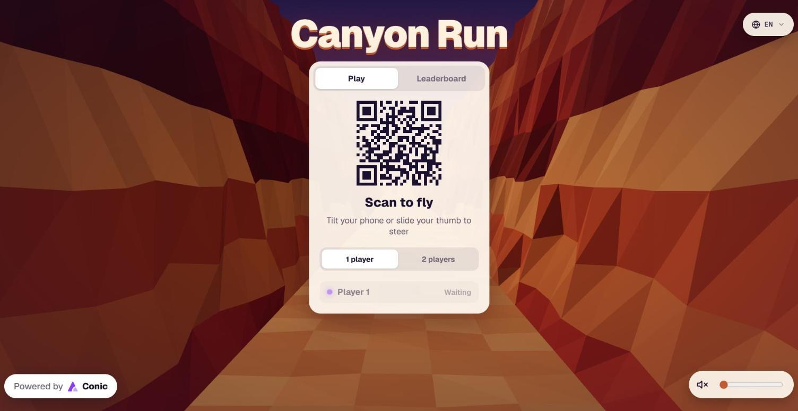

# Canyon Run

[](https://useconic.dev/templates/canyon-run?ref=canyon-run)

A multiplayer 3D game on Cloudflare Workers that you steer by tilting your phone. **[Play the demo](https://canyon.useconic.dev)** · **[Template page](https://useconic.dev/templates/canyon-run?ref=canyon-run)**



Open the game on a computer and scan the QR code with your phone. The phone becomes the controller. You can play alone or with two phones on one screen. The canyon gets faster and narrower the further you go, and the best distances go on a leaderboard.

## Deploy with Conic

Canyon Run is a [Conic](https://useconic.dev/?ref=canyon-run) template. Conic lets you deploy to Cloudflare like you deploy to Vercel: import a repository, and every push goes live on your own Cloudflare account, with preview URLs, logs and instant rollbacks.

1. Open the [Canyon Run template](https://useconic.dev/templates/canyon-run?ref=canyon-run) and choose **Deploy now**.
2. Connect your Cloudflare account. Conic creates the Worker, the Durable Object and the D1 database for you, with nothing to fork.
3. Open your URL and scan the QR code.

When this repository gets a new version, your project shows **New version available**. Nothing changes until you choose **Update**. See [all Conic templates](https://useconic.dev/templates?ref=canyon-run).

## Stack

Canyon Run runs entirely on Cloudflare:

| Technology | Purpose |
| --- | --- |
| TanStack Start and React 19 | The screen, the phone controller and the server routes |
| Three.js | The canyon, the obstacles and the rocket in 3D |
| Durable Objects | One room per game: WebSockets between the screen and the phones |
| D1 | The leaderboard. The table is created on the first request, so there are no migrations to run |
| Cloudflare Workers | Serves the app and the WebSockets |

## Deploy with Wrangler

```sh
pnpm install
pnpm wrangler d1 create canyon-run   # add the printed database_id to wrangler.jsonc
pnpm deploy
```

On your own domain, set `SITE_URL` in `src/shared/site.ts`: the canonical link and the share card point to it.

## Run it locally

```sh
pnpm install
pnpm dev
```

Open http://localhost:3100 on your computer. To control the rocket from a phone, the phone must reach your computer. Use a tunnel, or open `/c/<room>` in a second browser window and drag on the ring to steer.

## How it plays

- Tap **Tap to launch** on the phone. The way you hold the phone at that moment is "straight ahead".
- Tilt left and right to turn, forward and back to go down and up.
- If the phone has no motion sensor, or you deny access to it, drag on the ring instead.
- With two players, the game starts when both phones are ready. The game ends when both rockets have crashed or quit.

## Credits

Inspired by a post from [joshtriedcoding](https://x.com/joshtriedcoding/status/2125615139860672849). Built by [Conic](https://useconic.dev/?ref=canyon-run).

## License

MIT
